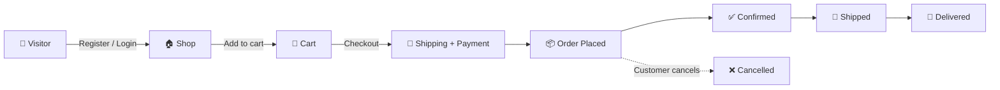

<div align="center">

# 🛍️ Scatch — Mini E-Commerce Platform

**A full-stack e-commerce app with carts, checkout, order tracking & an admin panel — all themed with your own colors.** 🎨

[](https://nodejs.org/)
[](https://expressjs.com/)
[](https://mongoosejs.com/)
[](https://ejs.co/)
[](https://tailwindcss.com/)
[](https://opensource.org/licenses/ISC)

[✨ Features](#-features) • [🏗️ Tech Stack](#️-tech-stack) • [📂 Structure](#-project-structure) • [⚙️ Setup](#️-setup--installation) • [🔑 Models](#-data-models) • [🛡️ Access](#️-access-control) • [🧪 Testing](#-cli-utilities--testing)

</div>

---

## 🧭 What is Scatch?

Scatch is a full-stack e-commerce web application built with **Node.js**, **Express 5**, **MongoDB (Mongoose)**, and **EJS**.
Customers can browse, add to cart, check out and track orders 📦 — while owners manage inventory from a dedicated admin panel 👑.

---

## ✨ Features

### 🔐 Authentication & Security
- 🍪 **JWT in HTTP-Only Cookies** — `httpOnly` + `SameSite: strict` for safe sessions
- 🔒 **bcrypt Password Hashing** — salted & hashed, never stored in plain text
- 🚦 **Brute-Force Protection** — `express-rate-limit` (10 attempts / 15 min on login routes)
- ✅ **Validation & Sanitization** — `express-validator` on register, login, products & checkout
- 🛂 **Role-Based Access (RBAC)** — `isLoggedIn` + `isOwner` separate `customer` and `admin`

### 🛒 Shopping Experience
- 🎨 **Dynamic Theming** — every product has its own `bgcolor`, `panelcolor` & `textcolor`
- 👀 **Active Catalog Filtering** — soft-deleted products are hidden from customers
- ➕➖ **Full Cart Management** — add, increase, decrease & remove with live bill + discount recalculation

### 💳 Checkout & Orders
- 📮 **Validated Shipping Flow** — full address, state, 6-digit pincode & 10-digit phone
- 💵 **Payment Options** — Cash on Delivery (`COD`) or `ONLINE`, with platform fee calculation
- 📜 **Order History & Details** — `/orders` and itemized `/orders/:id`
- ❌ **Self-Service Cancellation** — cancel anytime while status is `placed`
- 👤 **My Account** — profile + past orders at `/myaccount`

### 👑 Admin / Owner Panel
- 🔑 **Dedicated Admin Login** — rate-limited & role-guarded
- 📊 **Inventory Dashboard** — stock, prices, discounts at a glance
- 🖼️ **Create Products** — image uploads via Multer (in-memory buffer)
- ✏️ **Edit Products** — names, prices, discounts, images & hex colors
- 🗑️ **Soft Delete** — `isActive: false` keeps order history intact

### 🚨 Resilience & Quality
- 🧯 **Centralized Error Handling** — unified `errorHandler` + branded 404 page
- 🦸 **Admin Elevation CLI** — `scripts/createAdmin.js` promotes any user to admin
- 🧪 **Automated 9-Step Test Suite** — `scripts/verify-all.js`

---

## 🔄 How It Works



---

## 🏗️ Tech Stack

| Layer | Technology | Purpose |
|---|---|---|
| ⚙️ Runtime | Node.js | JavaScript runtime |
| 🚀 Framework | Express 5 | Routing & middleware |
| 🗄️ Database | MongoDB + Mongoose 9 | NoSQL storage & ODM |
| 🖥️ Templating | EJS | Server-side views |
| 🎨 Styling | Tailwind CSS + Remix Icon | Utility CSS & icons |
| 🔐 Auth | JWT (`jsonwebtoken`) + `bcrypt` | Stateless auth & hashing |
| 🚦 Security | `express-rate-limit` | Brute-force defense |
| ✅ Validation | `express-validator` | Input sanitization |
| 🖼️ File Uploads | Multer (memory storage) | Multipart image handling |
| 💬 Sessions/Flash | `express-session` + `connect-flash` | Flash messages |
| 🧩 Config | `dotenv` + `config` | Env & secrets |

---

## 📂 Project Structure

<details>
<summary><b>👉 Click to expand the folder tree</b></summary>

```text
scatch/
├── app.js                          # Express entry point & middleware mounting
├── .env                            # Environment secrets (not committed)
├── .env.example                    # Template for env config
├── config/
│   ├── development.json            # MongoDB URI config
│   ├── keys.js                     # JWT/session keys
│   ├── mongoose-connection.js      # DB connection & debug logger
│   └── multer-config.js            # Multer memory storage config
├── controllers/
│   ├── authController.js           # Register / login / logout
│   ├── orderController.js          # Checkout, tracking & cancellation
│   └── productController.js        # Admin list, create, update & soft-delete
├── middlewares/
│   ├── errorHandler.js             # Centralized error handling
│   ├── isLoggedIn.js               # JWT verification & user hydration
│   ├── isOwner.js                  # Admin role guard
│   ├── rateLimiter.js              # Rate limiter for auth routes
│   └── validators.js               # express-validator rules
├── models/
│   ├── user-model.js               # User schema (roles, cart w/ quantity, orders)
│   ├── product-model.js            # Product schema (colors, isActive flag)
│   └── order-model.js              # Order schema (address, items, fees, status)
├── routes/
│   ├── index.js                    # Home, /shop, cart, /myaccount
│   ├── orderRouter.js              # /orders/* (checkout, history, cancel)
│   ├── ownersRouter.js             # /owners/* (admin login & dashboard)
│   ├── productsRouter.js           # /owners/products/* (CRUD + soft delete)
│   └── usersRouter.js              # /users/* (register, login, logout)
├── scripts/
│   ├── createAdmin.js              # Promote a user to admin
│   └── verify-all.js               # 9-step integration test suite
├── util/
│   ├── asyncHandler.js             # Async error wrapper
│   └── generateToken.js            # JWT signing helper
├── views/
│   ├── index.ejs                   # Login / register landing
│   ├── shop.ejs                    # Product catalog
│   ├── cart.ejs                    # Cart & bill breakdown
│   ├── checkout.ejs                # Shipping & payment form
│   ├── order-confirmation.ejs      # Order success screen
│   ├── orders.ejs                  # Order history
│   ├── order-detail.ejs            # Order tracking & cancel button
│   ├── myaccount.ejs               # User profile
│   ├── admin.ejs                   # Admin inventory dashboard
│   ├── createproducts.ejs          # Create product form
│   ├── edit-product.ejs            # Edit product form
│   ├── owner-login.ejs             # Admin login portal
│   ├── error.ejs                   # Error & 404 page
│   └── partials/
│       ├── header.ejs
│       └── footer.ejs
├── public/                         # Static assets
└── postman/                        # Postman collections & test specs
```

</details>

---

## ⚙️ Setup & Installation

### 📋 Prerequisites
- 🟢 Node.js **v18+**
- 🍃 MongoDB running locally on `127.0.0.1:27017`, or a MongoDB Atlas URI

### 1️⃣ Clone & Install
```bash
git clone <repo-url>
cd scatch
npm install
```

### 2️⃣ Environment Variables
Create a `.env` file in the project root (see `.env.example`):
```env
PORT=3000
NODE_ENV=development
JWT_KEY=your_secure_jwt_secret_key
EXPRESS_SESSION_SECRET=your_secure_session_secret
MONGODB_URI=mongodb://127.0.0.1:27017/scatch
```

### 3️⃣ Run the App
```bash
node app.js
# or, with auto-reload 🔁
npx nodemon app.js
```

### 4️⃣ Open in Browser 🌐

| Page | URL |
|---|---|
| 🏠 Homepage (login/register) | `http://localhost:3000/` |
| 🛍️ Shop | `http://localhost:3000/shop` |
| 🛒 Cart | `http://localhost:3000/cart` |
| 📦 My Orders | `http://localhost:3000/orders` |
| 👤 My Account | `http://localhost:3000/myaccount` |
| 🔑 Owner Login | `http://localhost:3000/owners/login` |
| 👑 Admin Dashboard | `http://localhost:3000/owners/admin` |

---

## 🔑 Data Models

<details>
<summary><b>👤 User</b> — <code>models/user-model.js</code></summary>

```js
{
  fullname: String,
  email: { type: String, unique: true },
  password: String,        // bcrypt hashed
  role: { type: String, enum: ['customer', 'admin'], default: 'customer' },
  cart: [
    {
      product: { type: ObjectId, ref: 'product' },
      quantity: { type: Number, default: 1, min: 1 }
    }
  ],
  orders: [{ type: ObjectId, ref: 'order' }],
  contact: Number,
  picture: String
}
```
</details>

<details>
<summary><b>🏷️ Product</b> — <code>models/product-model.js</code></summary>

```js
{
  name: String,
  price: Number,
  discount: { type: Number, default: 0 },
  bgcolor: String,         // Hex, e.g. #f3f4f6
  panelcolor: String,      // Hex
  textcolor: String,       // Hex
  image: Buffer,           // Multer binary buffer
  isActive: { type: Boolean, default: true }   // soft-delete flag
}
```
</details>

<details>
<summary><b>📦 Order</b> — <code>models/order-model.js</code></summary>

```js
{
  user: { type: ObjectId, ref: 'user', required: true },
  products: [
    {
      product: { type: ObjectId, ref: 'product' },
      quantity: { type: Number, required: true },
      priceAtPurchase: { type: Number, required: true }
    }
  ],
  subtotal: Number,
  discount: { type: Number, default: 0 },
  platformFee: { type: Number, default: 20 },
  totalAmount: Number,
  shippingAddress: {
    fullname: String,
    address: String,
    city: String,
    state: String,
    pincode: String,       // 6-digit validation
    phone: String          // 10-digit validation
  },
  paymentMethod: { type: String, enum: ['COD', 'ONLINE'], default: 'COD' },
  paymentStatus: { type: String, enum: ['pending', 'paid', 'failed'], default: 'pending' },
  orderStatus: {
    type: String,
    enum: ['placed', 'confirmed', 'shipped', 'delivered', 'cancelled'],
    default: 'placed'
  },
  createdAt: { type: Date, default: Date.now }
}
```
</details>

---

## 🛡️ Access Control

<details open>
<summary><b>🌍 Public Routes</b></summary>

| Method | Endpoint | Description |
|---|---|---|
| `GET` | `/` | Landing page (login & register) |
| `POST` | `/users/register` | Register customer (validator guarded) |
| `POST` | `/users/login` | Customer login (rate-limited + validated) |
| `GET` | `/users/logout` | Logout & clear token |
| `GET` | `/owners/login` | Admin login portal |
| `POST` | `/owners/login` | Admin authentication (rate-limited) |
</details>

<details>
<summary><b>🙋 Customer Routes</b> — requires <code>isLoggedIn</code></summary>

| Method | Endpoint | Description |
|---|---|---|
| `GET` | `/shop` | Product catalog (active items only) |
| `GET` | `/addtocart/:productid` | Add to cart / increment quantity |
| `GET` | `/cart` | View cart & price breakdown |
| `POST` | `/cart/increase/:productid` | Increase quantity |
| `POST` | `/cart/decrease/:productid` | Decrease quantity (removes at 0) |
| `POST` | `/cart/remove/:productid` | Remove item entirely |
| `GET` | `/orders/checkout` | Checkout page with address form |
| `POST` | `/orders/checkout` | Submit shipping, create order, clear cart |
| `GET` | `/orders/:id/confirmation` | Order success page |
| `GET` | `/orders` | Order history |
| `GET` | `/orders/:id` | Itemized order details |
| `POST` | `/orders/:id/cancel` | Cancel order (only while `placed`) |
| `GET` | `/myaccount` | Profile + past orders |
</details>

<details>
<summary><b>👑 Admin Routes</b> — requires <code>isLoggedIn</code> + <code>isOwner</code></summary>

| Method | Endpoint | Description |
|---|---|---|
| `GET` | `/owners/admin` | Admin dashboard |
| `GET` | `/owners/logout` | Admin logout |
| `GET` | `/owners/products` | Manage inventory |
| `GET` | `/owners/products/create` | Product creation page |
| `POST` | `/owners/products` | Create product + image upload |
| `GET` | `/owners/products/:id/edit` | Product edit page |
| `POST` | `/owners/products/:id` | Update product details / image |
| `POST` | `/owners/products/:id/delete` | Soft-delete (`isActive: false`) |
</details>

---

## 🧪 CLI Utilities & Testing

### 🦸 Promote a User to Admin
```bash
node scripts/createAdmin.js <user-email>

# Example
node scripts/createAdmin.js admin@example.com
```

### 🤖 Run the Automated Test Suite
```bash
node scripts/verify-all.js
```

<details>
<summary><b>✅ What gets verified (9 steps)</b></summary>

- [x] 1️⃣ User registration, login & `/shop` browsing
- [x] 2️⃣ Cart ops — add, increment, decrement, totals, removal
- [x] 3️⃣ Checkout, shipping validation, order creation & cart emptying
- [x] 4️⃣ Order history, itemized details & cancellation
- [x] 5️⃣ Admin login & inventory CRUD (create, update, soft-delete)
- [x] 6️⃣ Soft-deleted items excluded from `/shop`
- [x] 7️⃣ Form validation rejection & friendly flash redirects
- [x] 8️⃣ Centralized 404 handler
- [x] 9️⃣ Non-admin users blocked from admin routes
</details>

---

## 🗺️ Quick Start Cheat Sheet

```bash
npm install                          # 📥 install deps
cp .env.example .env                 # 🔧 configure env
node app.js                          # 🚀 start server
node scripts/createAdmin.js you@x.com  # 👑 become admin
node scripts/verify-all.js           # 🧪 run tests
```

---

## 📄 License

This project is licensed under the **ISC License** 📜

<div align="center">

⭐ **If you like this project, give it a star!** ⭐

</div>
